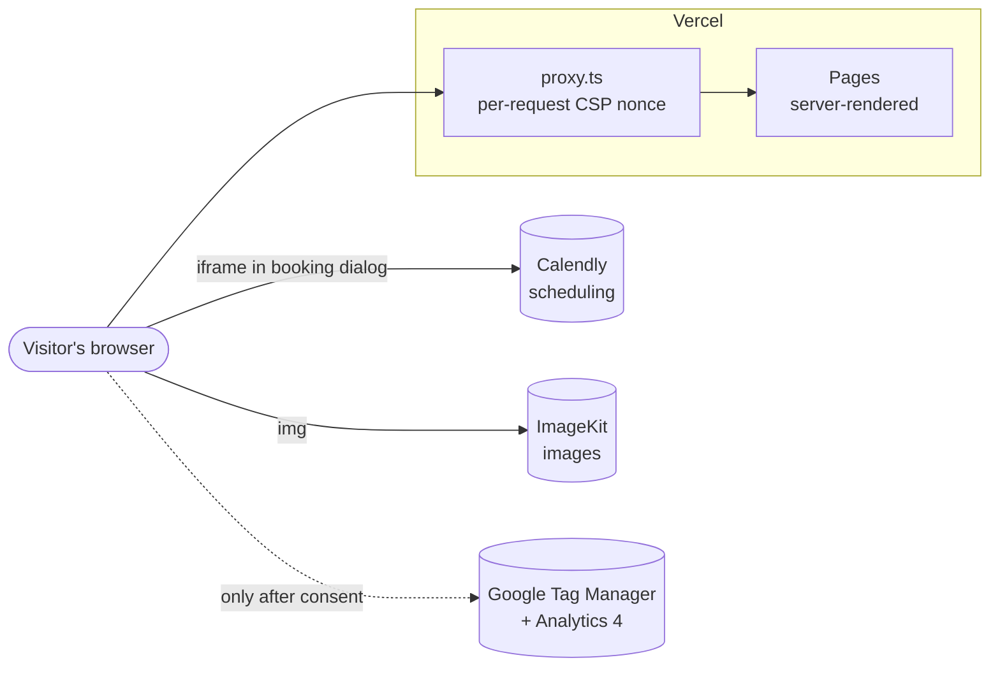
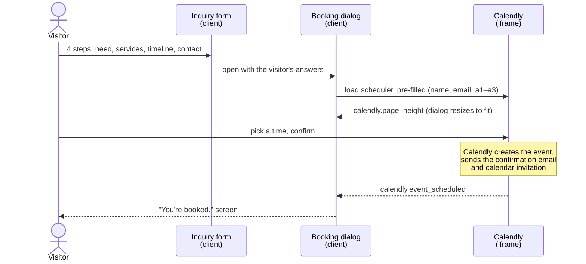
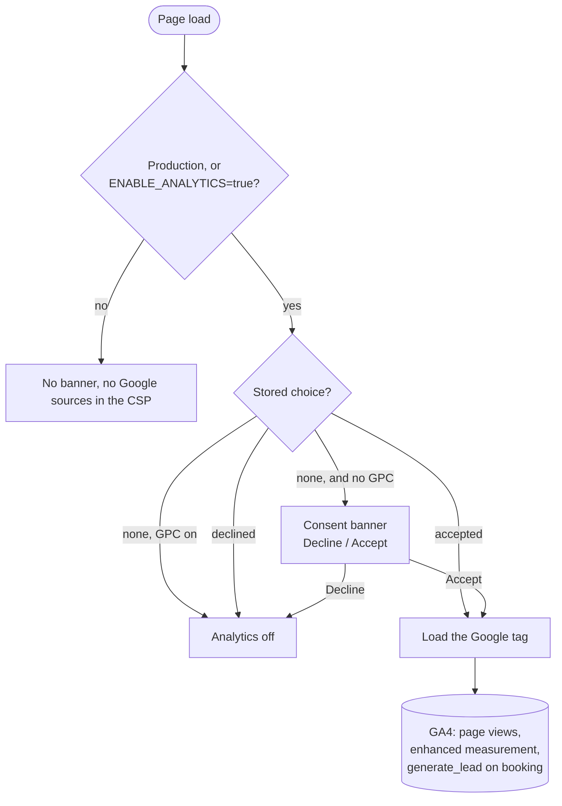

# Architecture

How the Nuvato AI site works, and why it is built this way. For setup and commands, see the [README](../README.md); for how to make changes, see [CONTRIBUTING](../CONTRIBUTING.md).

## System overview

A Next.js 16 App Router site on Vercel. It has no database, no API routes, and no secrets of its own. It uses three external services, all loaded directly by the visitor's browser:

| Service      | Used for                                                         | Configured in                     |
| ------------ | ---------------------------------------------------------------- | --------------------------------- |
| **Calendly** | Availability, booking, confirmation emails, calendar invitations | `lib/site-config.ts` (`consultation`) |
| **ImageKit** | Storing and serving every site image                             | `lib/assets.ts`                   |
| **Google Tag Manager / Analytics 4** | Usage analytics, only after the visitor consents, on production only | `lib/site-config.ts` (`analytics`) |

Because the site holds no credentials and stores no visitor data, there is nothing on the server for an attacker to extract. The Calendly account, ImageKit library, and Tag Manager container are managed in their own dashboards.

## Request lifecycle

1. **`proxy.ts`** runs for every page request (not for static files or icons). It generates a random nonce and sets the `Content-Security-Policy` header on both the request and the response.
2. **`next.config.ts`** adds the static security headers (HSTS, `nosniff`, `X-Frame-Options`, and others) to every response.
3. **`app/layout.tsx`** calls `connection()`, which makes every page render per request. This is required: Next.js reads the nonce from the request's CSP header during rendering and adds it to its own `<script>` tags. A statically pre-rendered page would have no nonce, and the CSP would block its scripts.
4. The page renders on the server and streams to the browser, which hydrates only the client components.

Metadata routes (`robots.txt`, `sitemap.xml`, `manifest.webmanifest`) and app icons are built once at build time.

## Rendering model

The homepage is composed in `components/home/HomePage.tsx`. Everything is a **server component** unless it needs browser state or events:

| Server components (no JavaScript sent)                                                       | Client components (`'use client'`)                                                                 |
| -------------------------------------------------------------------------------------------- | --------------------------------------------------------------------------------------------------- |
| `Hero`, `CommandCenter`, `ProblemsSection`, `WhySection`, `ProcessSection`, `StatsBand`, `SecuritySection`, `FaqSection`, `ContactSection`, `SiteFooter`, `LegalPage`, `BlogIndex`, `BlogArticle` (and the post's MDX), `BlogCta` | `SiteHeader`, `ServicesSection` (tabs), `AgentsSection`, `AgentDirectory` (search), `Inquiry` (form), `Booking` (dialog), `ScrollEffects`, `Counter`, `SpotlightCard`, `ServiceLink`, `BlogHeader`, `BlogToc` (section tracking), `BlogShare` (copy link) |

Sections that are mostly static but need one interactive element keep that element as a tiny client component. For example, `ProblemsSection` is server-rendered and uses `ServiceLink` for its "What we do" links.

### Shared state

Some interactions cross sections: "Deploy" in the agent catalog pre-fills the consultation form, and the header's service menu opens a tab in the services explorer. That state lives in **`HomeState.tsx`**, a React context provided at the top of `HomePage`:

| State           | Set by                                    | Read by                     |
| --------------- | ----------------------------------------- | --------------------------- |
| `activeService` | `SiteHeader`, `ServiceLink`, `ServicesSection` | `ServicesSection`           |
| `selection`     | `ServicesSection`, `AgentDirectory`       | `Inquiry` (pre-fills the form) |
| `booking`       | `Inquiry` (last step)                     | `BookingHost` (opens the dialog) |

The booking dialog renders at the end of the page (`BookingHost`), not inside the contact section, so it doesn't inherit that section's dark-panel styles.

### Search-engine visibility

All content is in the server-rendered HTML, including every service panel, agent, and FAQ answer. Interactive filtering only toggles the `hidden` attribute; it never removes content. Tests in `tests/home.test.tsx` enforce this.

## Booking flow

Booking is handled by **Calendly**, embedded in the site's own booking dialog.

How it fits together (`components/home/Booking.tsx`, `lib/calendly.ts`):

- **Embedded as a plain iframe, without Calendly's `widget.js`.** Loading third-party script would mean loosening the CSP's `script-src`. The iframe needs only `frame-src https://calendly.com`.
- **Pre-filled.** `calendlyEmbedUrl()` passes the visitor's name and email, plus the company, services, and project notes as custom answers `a1`–`a3`. These map to the Calendly event type's questions **in order**, so keep them as 1. Company, 2. Services of interest, 3. Project details.
- **Matches the site.** The same URL sets Calendly's colors to the design tokens and hides the event details the dialog already shows. The dialog itself pairs a navy brand panel (logo, meeting facts, who is booking, next steps) with the scheduler, and stacks into a compact header on narrow screens.
- **Trusted messages only.** Calendly reports the page height and a confirmed booking with `postMessage`. `readCalendlyEvent()` ignores any message not from exactly `https://calendly.com`, so another page or frame can't fake a confirmed booking.
- **Graceful failure.** If the scheduler hasn't loaded within 15 seconds (offline, or blocked by a browser extension), the dialog offers a direct link to the Calendly page.
- **Nothing is stored by this site.** Answers stay in browser memory until the scheduler opens, and then go only to Calendly.

The event link, name, and duration live in `siteConfig.consultation` (`lib/site-config.ts`). Calendly settings (availability, buffers, reminders, questions) are managed in the Calendly dashboard. **Never add a phone-number question or text reminders**: the site promises that booking doesn't collect a phone number or enroll anyone in SMS, and the SMS carrier registration relies on that.

## Analytics and consent

Google Analytics 4 runs through the Google Tag Manager container in `siteConfig.analytics` (`components/analytics/`, `lib/consent.ts`, `lib/analytics.ts`).

- **Nothing loads before consent.** `Analytics` renders the Google tag only once the visitor accepts (or accepted before), so no request reaches Google, and no cookie is set, without a "yes". This matches the Privacy Policy's promise to ask first.
- **Consent Mode v2.** The bootstrap script sets every signal to denied, then grants `analytics_storage` only. `ad_storage`, `ad_user_data`, and `ad_personalization` stay denied: the container holds no advertising tags.
- **Global Privacy Control** counts as declining, with no banner, unless the visitor accepts in Cookie settings.
- **Withdrawing is as easy as consenting.** "Cookie settings" in every footer reopens the banner. Declining after accepting updates consent, deletes the `_ga` cookies, and reloads the page without the tag.
- **The choice** is stored in `localStorage` (`CONSENT_STORAGE_KEY`), which is strictly necessary to remember it. Bump the key's version to ask everyone again after a material policy change.
- **Production only.** `siteEnv.analyticsEnabled` is true on Vercel production deployments (or with `ENABLE_ANALYTICS=true`), so previews and local development send nothing. When it's false, there is no banner, no "Cookie settings" link, and no Google source in the CSP.
- **CSP.** Both Google tag scripts carry the request nonce (`proxy.ts` passes it to `app/layout.tsx` as `x-nonce`). With analytics enabled, the CSP adds exactly the sources Google documents for GA4. Tags from other vendors in the container are blocked until the code allows them; see [CONTRIBUTING](../CONTRIBUTING.md#add-or-change-an-analytics-tag).
- **Conversions.** A confirmed Calendly booking sends GA4's recommended `generate_lead` event, with no personal data.

## Security model

| Layer                 | Where                         | What it does                                                                      |
| --------------------- | ----------------------------- | --------------------------------------------------------------------------------- |
| Content-Security-Policy | `proxy.ts`, `lib/security.ts` | Scripts only from the site, the request nonce, and (with analytics enabled) Google Tag Manager; images only from the site, the ImageKit folder, and Google Analytics; frames only from Calendly; no plugins, foreign form targets, or framing of this site |
| Static headers        | `next.config.ts`              | HSTS, `nosniff`, `X-Frame-Options: DENY`, COOP, Referrer-Policy, Permissions-Policy |
| Indexing control      | `lib/env.ts`                  | Production is indexable on `nuvato.ai` only (`SITE_INDEXABLE=false` closes it); other hosts, such as `*.vercel.app`, and every preview deployment send `noindex` |
| Booking messages      | `lib/calendly.ts`             | Only messages from `https://calendly.com` are trusted                             |
| Analytics consent     | `components/analytics/`       | No Google request or cookie before consent; GPC honored; production only          |
| Supply chain          | `pnpm-workspace.yaml`, CI     | 7-day minimum release age, install scripts allowlisted, `pnpm audit` in CI, actions pinned to commits |

`style-src` allows `'unsafe-inline'` because the hero animation delays and the navigation highlight use inline style attributes, which nonces cannot cover. `script-src` never allows inline scripts without the nonce, `eval` in production, or third-party scripts other than Google Tag Manager.

Apart from Google Analytics cookies after consent, the site sets no cookies and loads no other third-party scripts. Calendly's scheduler, which loads only when a visitor opens the booking dialog, sets its own cookies inside its frame and shows its own consent banner where required (it is deliberately not hidden). Adding any other third-party service requires a CSP change, a Privacy Policy update, and possibly a consent banner. See [SECURITY.md](../SECURITY.md).

## Images

ImageKit is the single source of truth for images; the repository has no `public/` folder.

- **`lib/assets.ts`** registers every image path (`images.brandMark`, `toolLogo('hubspot')`, …) and builds URLs.
- **`lib/imagekit-loader.ts`** is the global `next/image` loader. It requests `tr=w-<width>,c-at_max,q-<quality>`: the width each screen needs, never upscaled, as WebP or AVIF when the browser supports it.
- **Exact originals** (`tr=orig-true`) are used for SVG tool logos, the social card, and the structured-data logo, because ImageKit's automatic conversion would otherwise rasterize SVGs and drop PNG transparency.
- **Blog header images** (`blog/<file>` in ImageKit) are always served as exact originals, on the page, in `og:image`, and in the JSON-LD. Their files embed the title, alt text, and an IPTC "AI-generated" marker, and ImageKit strips all metadata from resized images. `pnpm test:assets` checks that the served file still carries the marker.
- **App icons and fonts** stay in `app/` because browsers fetch them from the site's own domain.

`pnpm test:assets` (also run in CI) checks that every registered image exists in ImageKit with the right file type.

## Styling

Hand-written CSS with design tokens, no CSS framework. All files in `app/styles/` are imported globally by `app/layout.tsx`, **in a fixed order**:

| File             | Covers                                                                        |
| ---------------- | ----------------------------------------------------------------------------- |
| `globals.css`    | Design tokens (`:root`), base elements, buttons, most homepage sections, and legal pages |
| `agents.css`     | Agents section, the illustrative workspace, and the IGV family bar            |
| `tools.css`      | Tool logos, the integration map, and bento cards                              |
| `navigation.css` | Header, services menu, and mobile drawer                                      |
| `directory.css`  | Agent directory                                                               |
| `booking.css`    | Booking dialog: navy brand panel beside the Calendly scheduler, stacking on narrow screens |
| `consent.css`    | Analytics consent banner and the "Cookie settings" footer links                   |
| `blog.css`       | Blog index and posts: hero panel, overlapping image card, contents list, numbered sections, closing panel |
| `polish.css`     | Final refinements that override earlier files; must stay last                 |

Conventions used across components:

- `data-nav-tone="dark"` on a section switches the header to its dark style while over it.
- `data-reveal` fades a section in when it scrolls into view; `data-animate` plays its animation only while on screen (both handled by `ScrollEffects`).
- Fonts are exposed as `--font-body`, `--font-heading`, and `--font-mono`.
- Every animation respects `prefers-reduced-motion`.

### Navigation

`components/home/SiteHeader.tsx` and `app/styles/navigation.css`:

| Feature               | Implementation                                                                                                         |
| --------------------- | ---------------------------------------------------------------------------------------------------------------------- |
| **Frosted glass**     | `backdrop-filter` on the bar's `::before` layer, so the services menu can blur the page itself.                        |
| **Adaptive tone**     | Switches to the dark style over sections marked `data-nav-tone="dark"`.                                                |
| **Sliding highlight** | One pill follows the hovered or focused item. It is positioned imperatively, so pointer movement never re-renders React. |
| **Scroll-spy**        | `aria-current="location"` marks the section in view; a hairline shows reading progress.                                |
| **Services menu**     | ArrowDown to enter, Escape to close and return focus, closes on outside click or focus, `inert` while closed.          |
| **Mobile sheet**      | Native `<dialog>` (`showModal`) for a built-in focus trap. Focus moves to the destination heading after navigation.    |
| **Fallbacks**         | Opaque surfaces without `backdrop-filter`; respects reduced transparency, increased contrast, and reduced motion.       |

## Content

Copy lives in data files, not in components:

| File                   | Contains                                                       |
| ---------------------- | -------------------------------------------------------------- |
| `lib/content.ts`       | Services, agents, process steps, FAQs, tool names              |
| `lib/legal-content.ts` | Privacy Policy, Terms, SMS Terms, and their dates (`legalMeta`) |
| `lib/site-config.ts`   | Business identity, legal contact, login URL                    |
| `lib/seo.ts`           | Page titles, descriptions, and JSON-LD built from the content above |
| `content/blog/`        | Blog posts: `<slug>.mdx` and `<slug>.schema.json`, exactly as the content team delivered them |
| `lib/blog.ts`          | The list of published posts, plus their metadata and JSON-LD   |

Structured data is generated from the same content the page shows, so it can't drift. `tests/seo.test.ts` checks that the FAQ schema matches the visible answers.

### Blog

Posts are approved by the content team before they reach the code, so the repository stores them **unchanged**: the MDX file (YAML frontmatter, then the text) and its JSON-LD file. `content/` is excluded from Prettier so formatting never touches them.

- **Rendering.** `@next/mdx` compiles each post at build time. `remark-frontmatter` and `remark-mdx-frontmatter` export the frontmatter, which `lib/blog.ts` validates: a missing field fails the build with the file and field name. Posts render as plain HTML (`mdx-components.tsx`), styled by `.blog-copy`. MDX can run code, so review a post's diff like code.
- **Routes.** `/blog/` lists the posts and `/blog/<slug>/` shows one. Only slugs in `blogPosts` exist; anything else is a 404.
- **Design.** Blog pages are built from the homepage's parts, not new ones: the navy hero panel with horizon rings, a white card overlapping its lower edge (like the command center), and the closing consultation panel (`BlogCta`, with copy shared with the homepage through `consultationInvite`). `BlogHeader` is the site navigation for pages other than the homepage: the same glass bar, adaptive tone, reading progress, and mobile drawer, linking back to homepage sections. The footer is the homepage's `SiteFooter` with `hrefBase="/"`.
- **Reading aids, without touching the words.** The post's first paragraph (its summary) is set apart as "The short answer". Each `##` section gets an id from its words and a CSS-generated "01 / 09" label. "On this page" lists the sections: it is read from the compiled MDX on the server (`headingsOf()`), so it is in the HTML, and `BlogToc` then highlights the section being read. Below 1100px it becomes a collapsible list above the post.
- **Metadata.** The frontmatter's `seoTitle` and `description` become the title, description, Open Graph, and Twitter tags. The header image is the social image, and `og:type` is `article` with the published and modified dates.
- **Structured data.** The page embeds the delivered JSON-LD and adds only what the content team can't know: the page address (`url`, `mainEntityOfPage`) and the image address (`image.url`, `image.contentUrl`).
- **Approved text stays approved.** `tests/blog.test.tsx` checks that each post's word count still matches its frontmatter, that every FAQ entry is a visible heading and answer, and that the JSON-LD matches the visible post.

## Testing

| Suite                  | Covers                                                                        |
| ---------------------- | ----------------------------------------------------------------------------- |
| `home.test.tsx`        | Server-rendered HTML: one `<h1>`, unique IDs, working anchors, section order, all content present, only registered images |
| `legal.test.tsx`       | Every legal page renders, dates and contact present, carrier-required SMS phrases |
| `blog.test.tsx`        | Every post: one `<h1>`, approved word count, header image (original file, alt, caption, AI note), FAQ visible, JSON-LD and article metadata, sitemap and index |
| `seo.test.ts`          | Metadata, structured data, robots, sitemap, environment handling              |
| `security.test.ts`     | CSP directives and security headers                                          |
| `calendly.test.ts`     | Embed URL (pre-fill, appearance, cookie banner kept), trusted-origin message handling, frame-src |
| `analytics.test.ts`    | Container ID, production-only switch, CSP with analytics on and off, consent store (GPC, broken storage), cookie cleanup, Privacy Policy wording |
| `assets.test.ts`       | Image URLs; with `pnpm test:assets`, that every image exists in ImageKit and blog images keep their AI-generated marker |

Tests never call Calendly or create bookings. Components are rendered with `react-dom/server`, so tests check the same HTML search engines receive.
