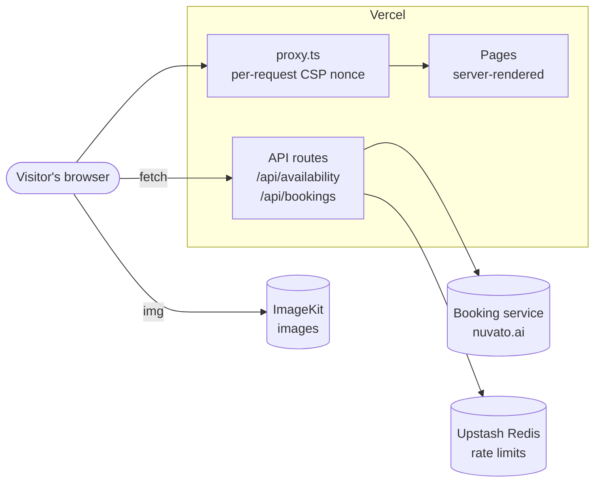
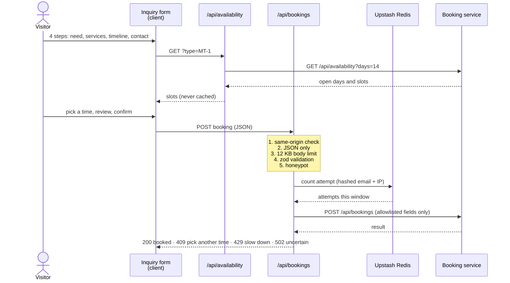

# Architecture

How the Nuvato AI site works, and why it is built this way. For setup and commands, see the [README](../README.md); for how to make changes, see [CONTRIBUTING](../CONTRIBUTING.md).

## System overview

A Next.js 16 App Router site on Vercel. It has no database of its own. It talks to three external services:

| Service                    | Used for                                   | Called from        | Configured by                   |
| -------------------------- | ------------------------------------------ | ------------------ | ------------------------------- |
| **Booking service** (`nuvato.ai`) | Live availability and creating appointments | Server (API routes) | `BOOKING_SERVICE_ORIGIN`        |
| **Upstash Redis**          | Booking rate-limit counters                | Server             | `KV_REST_API_URL`, `KV_REST_API_TOKEN` |
| **ImageKit**               | Storing and serving every site image       | Browser            | `lib/assets.ts` (built-in default) |

The browser never talks to the booking service or Redis directly. API routes validate and forward requests, so credentials and upstream URLs stay on the server.

## Request lifecycle

1. **`proxy.ts`** runs for every page request (not for API routes, static files, or icons). It generates a random nonce and sets the `Content-Security-Policy` header on both the request and the response.
2. **`next.config.ts`** adds the static security headers (HSTS, `nosniff`, `X-Frame-Options`, and others) to every response, including API routes.
3. **`app/layout.tsx`** calls `connection()`, which makes every page render per request. This is required: Next.js reads the nonce from the request's CSP header during rendering and adds it to its own `<script>` tags. A statically pre-rendered page would have no nonce, and the CSP would block its scripts.
4. The page renders on the server and streams to the browser, which hydrates only the client components.

Metadata routes (`robots.txt`, `sitemap.xml`, `manifest.webmanifest`) and app icons are built once at build time.

## Rendering model

The homepage is composed in `components/home/HomePage.tsx`. Everything is a **server component** unless it needs browser state or events:

| Server components (no JavaScript sent)                                                       | Client components (`'use client'`)                                                                 |
| -------------------------------------------------------------------------------------------- | --------------------------------------------------------------------------------------------------- |
| `Hero`, `CommandCenter`, `ProblemsSection`, `WhySection`, `ProcessSection`, `StatsBand`, `SecuritySection`, `FaqSection`, `ContactSection`, `SiteFooter`, `LegalPage` | `SiteHeader`, `ServicesSection` (tabs), `AgentsSection`, `AgentDirectory` (search), `Inquiry` (form), `Booking` (dialog), `ScrollEffects`, `Counter`, `SpotlightCard`, `ServiceLink` |

Sections that are mostly static but need one interactive element keep that element as a tiny client component. For example, `ProblemsSection` is server-rendered and uses `ServiceLink` for its "What we do" links.

### Shared state

Some interactions cross sections: "Deploy" in the agent catalog pre-fills the consultation form, and the header's service menu opens a tab in the services explorer. That state lives in **`HomeState.tsx`**, a React context provided at the top of `HomePage`:

| State           | Set by                                    | Read by                     |
| --------------- | ----------------------------------------- | --------------------------- |
| `activeService` | `SiteHeader`, `ServiceLink`, `ServicesSection` | `ServicesSection`           |
| `selection`     | `ServicesSection`, `AgentDirectory`       | `Inquiry` (pre-fills the form) |
| `booking`       | `Inquiry` (last step)                     | `BookingHost` (opens the dialog) |

The booking dialog renders at the end of the page (`BookingHost`), not inside the contact section, so it doesn't inherit that section's dark-panel styles.

### Search-engine visibility

All content is in the server-rendered HTML, including every service panel, agent, and FAQ answer. Interactive filtering only toggles the `hidden` attribute; it never removes content. Tests in `tests/home.test.tsx` enforce this.

## Booking flow

Design decisions:

- **Nothing is stored by this site.** The visitor's details stay in browser memory until they confirm, then go straight to the booking service.
- **Fails closed.** If Redis is unreachable or not configured in production, booking returns 503 instead of accepting unlimited attempts. Local development uses an in-memory limiter (`lib/rate-limit.ts`).
- **Never retries a write.** A timed-out request may still have created the appointment, so an uncertain result (502 with `uncertain: true`) tells the visitor to check their email before trying again, and disables the confirm button.
- **Privacy-preserving counters.** Rate-limit keys are SHA-256 hashes of the email and IP, scoped to a 15-minute window. No raw email or IP is ever stored.
- **Limits:** 5 attempts per email and 10 per IP per 15 minutes.

The handler is built by `createBookingHandler(limit)` in `lib/booking.ts`, which takes the rate limiter as a parameter so tests can substitute one.

## Security model

| Layer                 | Where                         | What it does                                                                      |
| --------------------- | ----------------------------- | --------------------------------------------------------------------------------- |
| Content-Security-Policy | `proxy.ts`, `lib/security.ts` | Scripts only from the site and the request nonce; images only from the site and the ImageKit folder; no framing, plugins, or foreign form targets |
| Static headers        | `next.config.ts`              | HSTS, `nosniff`, `X-Frame-Options: DENY`, COOP, Referrer-Policy, Permissions-Policy |
| Indexing control      | `lib/env.ts`                  | `noindex` everywhere until `SITE_INDEXABLE=true`, and always on preview deployments |
| API input handling    | `lib/booking.ts`              | Same-origin, JSON-only, size-limited, schema-validated, honeypot, rate-limited    |
| Supply chain          | `pnpm-workspace.yaml`, CI     | 7-day minimum release age, install scripts allowlisted, `pnpm audit` in CI, actions pinned to commits |

`style-src` allows `'unsafe-inline'` because the hero animation delays and the navigation highlight use inline style attributes, which nonces cannot cover. `script-src` never allows inline scripts.

The site sets no cookies and loads no analytics or third-party scripts. Adding any of these requires a CSP change, a Privacy Policy update, and possibly a consent banner. See [SECURITY.md](../SECURITY.md).

## Images

ImageKit is the single source of truth for images; the repository has no `public/` folder.

- **`lib/assets.ts`** registers every image path (`images.brandMark`, `toolLogo('hubspot')`, …) and builds URLs.
- **`lib/imagekit-loader.ts`** is the global `next/image` loader. It requests `tr=w-<width>,c-at_max,q-<quality>`: the width each screen needs, never upscaled, as WebP or AVIF when the browser supports it.
- **Exact originals** (`tr=orig-true`) are used for SVG tool logos, the social card, and the structured-data logo, because ImageKit's automatic conversion would otherwise rasterize SVGs and drop PNG transparency.
- **App icons and fonts** stay in `app/` because browsers fetch them from the site's own domain.

`pnpm test:assets` (also run in CI) checks that every registered image exists in ImageKit with the right file type.

## Styling

Hand-written CSS with design tokens, no CSS framework. All files in `app/styles/` are imported globally by `app/layout.tsx`, **in a fixed order**:

| File             | Covers                                                                        |
| ---------------- | ----------------------------------------------------------------------------- |
| `globals.css`    | Design tokens (`:root`), base elements, buttons, and most homepage sections, booking, and legal pages |
| `agents.css`     | Agents section, the illustrative workspace, and the IGV family bar            |
| `tools.css`      | Tool logos, the integration map, and bento cards                              |
| `navigation.css` | Header, services menu, and mobile drawer                                      |
| `directory.css`  | Agent directory                                                               |
| `polish.css`     | Final refinements that override earlier files; must stay last                 |

Conventions used across components:

- `data-nav-tone="dark"` on a section switches the header to its dark style while over it.
- `data-reveal` fades a section in when it scrolls into view; `data-animate` plays its animation only while on screen (both handled by `ScrollEffects`).
- Fonts are exposed as `--font-body`, `--font-heading`, and `--font-mono`.
- Every animation respects `prefers-reduced-motion`.

### Navigation

`components/home/SiteHeader.tsx` and `app/styles/navigation.css`:

| Feature               | Implementation                                                                                                         |
| --------------------- | ---------------------------------------------------------------------------------------------------------------------- |
| **Frosted glass**     | `backdrop-filter` on the bar's `::before` layer, so the services menu can blur the page itself.                        |
| **Adaptive tone**     | Switches to the dark style over sections marked `data-nav-tone="dark"`.                                                |
| **Sliding highlight** | One pill follows the hovered or focused item. It is positioned imperatively, so pointer movement never re-renders React. |
| **Scroll-spy**        | `aria-current="location"` marks the section in view; a hairline shows reading progress.                                |
| **Services menu**     | ArrowDown to enter, Escape to close and return focus, closes on outside click or focus, `inert` while closed.          |
| **Mobile sheet**      | Native `<dialog>` (`showModal`) for a built-in focus trap. Focus moves to the destination heading after navigation.    |
| **Fallbacks**         | Opaque surfaces without `backdrop-filter`; respects reduced transparency, increased contrast, and reduced motion.       |

## Content

Copy lives in data files, not in components:

| File                   | Contains                                                       |
| ---------------------- | -------------------------------------------------------------- |
| `lib/content.ts`       | Services, agents, process steps, FAQs, tool names              |
| `lib/legal-content.ts` | Privacy Policy, Terms, SMS Terms, and their dates (`legalMeta`) |
| `lib/site-config.ts`   | Business identity, legal contact, login URL                    |
| `lib/seo.ts`           | Page titles, descriptions, and JSON-LD built from the content above |

Structured data is generated from the same content the page shows, so it can't drift. `tests/seo.test.ts` checks that the FAQ schema matches the visible answers.

## Testing

| Suite                  | Covers                                                                        |
| ---------------------- | ----------------------------------------------------------------------------- |
| `home.test.tsx`        | Server-rendered HTML: one `<h1>`, unique IDs, working anchors, section order, all content present, only registered images |
| `legal.test.tsx`       | Every legal page renders, dates and contact present, carrier-required SMS phrases |
| `seo.test.ts`          | Metadata, structured data, robots, sitemap, environment handling              |
| `security.test.ts`     | CSP directives and security headers                                          |
| `booking.test.ts`      | Every rejection path and upstream outcome of the booking API, with mocked network |
| `rate-limit.test.ts`   | In-memory and Redis limiters, hashing, fail-closed behavior                   |
| `assets.test.ts`       | Image URLs; with `pnpm test:assets`, that every image exists in ImageKit      |

Tests never call the real booking service. Components are rendered with `react-dom/server`, so tests check the same HTML search engines receive.
