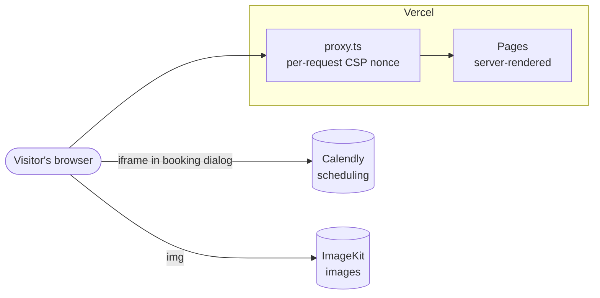
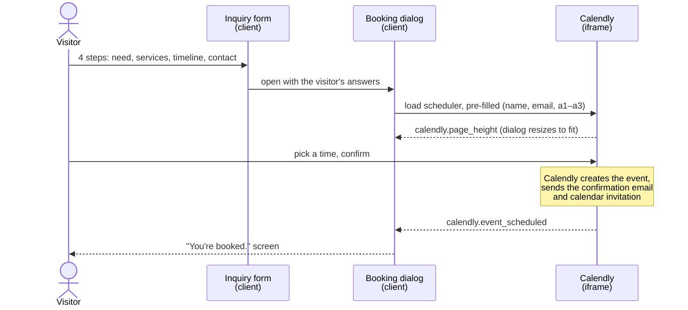

# Architecture

How the Nuvato AI site works, and why it is built this way. For setup and commands, see the [README](../README.md); for how to make changes, see [CONTRIBUTING](../CONTRIBUTING.md).

## System overview

A Next.js 16 App Router site on Vercel. It has no database, no API routes, and no secrets of its own. It uses two external services, both loaded directly by the visitor's browser:

| Service      | Used for                                                         | Configured in                     |
| ------------ | ---------------------------------------------------------------- | --------------------------------- |
| **Calendly** | Availability, booking, confirmation emails, calendar invitations | `lib/site-config.ts` (`consultation`) |
| **ImageKit** | Storing and serving every site image                             | `lib/assets.ts`                   |

Because the site holds no credentials and stores no visitor data, there is nothing on the server for an attacker to extract. The Calendly account and ImageKit library are managed in their own dashboards.

## Request lifecycle

1. **`proxy.ts`** runs for every page request (not for static files or icons). It generates a random nonce and sets the `Content-Security-Policy` header on both the request and the response.
2. **`next.config.ts`** adds the static security headers (HSTS, `nosniff`, `X-Frame-Options`, and others) to every response.
3. **`app/layout.tsx`** calls `connection()`, which makes every page render per request. This is required: Next.js reads the nonce from the request's CSP header during rendering and adds it to its own `<script>` tags. A statically pre-rendered page would have no nonce, and the CSP would block its scripts.
4. The page renders on the server and streams to the browser, which hydrates only the client components.

Metadata routes (`robots.txt`, `sitemap.xml`, `manifest.webmanifest`) and app icons are built once at build time.

## Rendering model

The homepage is composed in `components/home/HomePage.tsx`. Everything is a **server component** unless it needs browser state or events:

| Server components (no JavaScript sent)                                                       | Client components (`'use client'`)                                                                 |
| -------------------------------------------------------------------------------------------- | --------------------------------------------------------------------------------------------------- |
| `Hero`, `CommandCenter`, `ProblemsSection`, `WhySection`, `ProcessSection`, `StatsBand`, `SecuritySection`, `FaqSection`, `ContactSection`, `SiteFooter`, `LegalPage` | `SiteHeader`, `ServicesSection` (tabs), `AgentsSection`, `AgentDirectory` (search), `Inquiry` (form), `Booking` (dialog), `ScrollEffects`, `Counter`, `SpotlightCard`, `ServiceLink` |

Sections that are mostly static but need one interactive element keep that element as a tiny client component. For example, `ProblemsSection` is server-rendered and uses `ServiceLink` for its "What we do" links.

### Shared state

Some interactions cross sections: "Deploy" in the agent catalog pre-fills the consultation form, and the header's service menu opens a tab in the services explorer. That state lives in **`HomeState.tsx`**, a React context provided at the top of `HomePage`:

| State           | Set by                                    | Read by                     |
| --------------- | ----------------------------------------- | --------------------------- |
| `activeService` | `SiteHeader`, `ServiceLink`, `ServicesSection` | `ServicesSection`           |
| `selection`     | `ServicesSection`, `AgentDirectory`       | `Inquiry` (pre-fills the form) |
| `booking`       | `Inquiry` (last step)                     | `BookingHost` (opens the dialog) |

The booking dialog renders at the end of the page (`BookingHost`), not inside the contact section, so it doesn't inherit that section's dark-panel styles.

### Search-engine visibility

All content is in the server-rendered HTML, including every service panel, agent, and FAQ answer. Interactive filtering only toggles the `hidden` attribute; it never removes content. Tests in `tests/home.test.tsx` enforce this.

## Booking flow

Booking is handled by **Calendly**, embedded in the site's own booking dialog.

How it fits together (`components/home/Booking.tsx`, `lib/calendly.ts`):

- **Embedded as a plain iframe, without Calendly's `widget.js`.** Loading third-party script would mean loosening the CSP's `script-src`. The iframe needs only `frame-src https://calendly.com`.
- **Pre-filled.** `calendlyEmbedUrl()` passes the visitor's name and email, plus the company, services, and project notes as custom answers `a1`–`a3`. These map to the Calendly event type's questions **in order**, so keep them as 1. Company, 2. Services of interest, 3. Project details.
- **Matches the site.** The same URL sets Calendly's colors to the design tokens and hides the event details the dialog already shows.
- **Trusted messages only.** Calendly reports the page height and a confirmed booking with `postMessage`. `readCalendlyEvent()` ignores any message not from exactly `https://calendly.com`, so another page or frame can't fake a confirmed booking.
- **Graceful failure.** If the scheduler hasn't loaded within 15 seconds (offline, or blocked by a browser extension), the dialog offers a direct link to the Calendly page.
- **Nothing is stored by this site.** Answers stay in browser memory until the scheduler opens, and then go only to Calendly.

The event link, name, and duration live in `siteConfig.consultation` (`lib/site-config.ts`). Calendly settings (availability, buffers, reminders, questions) are managed in the Calendly dashboard. **Never add a phone-number question or text reminders**: the site promises that booking doesn't collect a phone number or enroll anyone in SMS, and the SMS carrier registration relies on that.

## Security model

| Layer                 | Where                         | What it does                                                                      |
| --------------------- | ----------------------------- | --------------------------------------------------------------------------------- |
| Content-Security-Policy | `proxy.ts`, `lib/security.ts` | Scripts only from the site and the request nonce; images only from the site and the ImageKit folder; frames only from Calendly; no plugins, foreign form targets, or framing of this site |
| Static headers        | `next.config.ts`              | HSTS, `nosniff`, `X-Frame-Options: DENY`, COOP, Referrer-Policy, Permissions-Policy |
| Indexing control      | `lib/env.ts`                  | `noindex` everywhere until `SITE_INDEXABLE=true`, and always on preview deployments |
| Booking messages      | `lib/calendly.ts`             | Only messages from `https://calendly.com` are trusted                             |
| Supply chain          | `pnpm-workspace.yaml`, CI     | 7-day minimum release age, install scripts allowlisted, `pnpm audit` in CI, actions pinned to commits |

`style-src` allows `'unsafe-inline'` because the hero animation delays and the navigation highlight use inline style attributes, which nonces cannot cover. `script-src` never allows inline or third-party scripts.

The site itself sets no cookies and loads no analytics or third-party scripts. Calendly's scheduler, which loads only when a visitor opens the booking dialog, sets its own cookies inside its frame and shows its own consent banner where required (it is deliberately not hidden). Adding any other third-party service requires a CSP change, a Privacy Policy update, and possibly a consent banner. See [SECURITY.md](../SECURITY.md).

## Images

ImageKit is the single source of truth for images; the repository has no `public/` folder.

- **`lib/assets.ts`** registers every image path (`images.brandMark`, `toolLogo('hubspot')`, …) and builds URLs.
- **`lib/imagekit-loader.ts`** is the global `next/image` loader. It requests `tr=w-<width>,c-at_max,q-<quality>`: the width each screen needs, never upscaled, as WebP or AVIF when the browser supports it.
- **Exact originals** (`tr=orig-true`) are used for SVG tool logos, the social card, and the structured-data logo, because ImageKit's automatic conversion would otherwise rasterize SVGs and drop PNG transparency.
- **App icons and fonts** stay in `app/` because browsers fetch them from the site's own domain.

`pnpm test:assets` (also run in CI) checks that every registered image exists in ImageKit with the right file type.

## Styling

Hand-written CSS with design tokens, no CSS framework. All files in `app/styles/` are imported globally by `app/layout.tsx`, **in a fixed order**:

| File             | Covers                                                                        |
| ---------------- | ----------------------------------------------------------------------------- |
| `globals.css`    | Design tokens (`:root`), base elements, buttons, and most homepage sections, booking, and legal pages |
| `agents.css`     | Agents section, the illustrative workspace, and the IGV family bar            |
| `tools.css`      | Tool logos, the integration map, and bento cards                              |
| `navigation.css` | Header, services menu, and mobile drawer                                      |
| `directory.css`  | Agent directory                                                               |
| `polish.css`     | Final refinements that override earlier files; must stay last                 |

Conventions used across components:

- `data-nav-tone="dark"` on a section switches the header to its dark style while over it.
- `data-reveal` fades a section in when it scrolls into view; `data-animate` plays its animation only while on screen (both handled by `ScrollEffects`).
- Fonts are exposed as `--font-body`, `--font-heading`, and `--font-mono`.
- Every animation respects `prefers-reduced-motion`.

### Navigation

`components/home/SiteHeader.tsx` and `app/styles/navigation.css`:

| Feature               | Implementation                                                                                                         |
| --------------------- | ---------------------------------------------------------------------------------------------------------------------- |
| **Frosted glass**     | `backdrop-filter` on the bar's `::before` layer, so the services menu can blur the page itself.                        |
| **Adaptive tone**     | Switches to the dark style over sections marked `data-nav-tone="dark"`.                                                |
| **Sliding highlight** | One pill follows the hovered or focused item. It is positioned imperatively, so pointer movement never re-renders React. |
| **Scroll-spy**        | `aria-current="location"` marks the section in view; a hairline shows reading progress.                                |
| **Services menu**     | ArrowDown to enter, Escape to close and return focus, closes on outside click or focus, `inert` while closed.          |
| **Mobile sheet**      | Native `<dialog>` (`showModal`) for a built-in focus trap. Focus moves to the destination heading after navigation.    |
| **Fallbacks**         | Opaque surfaces without `backdrop-filter`; respects reduced transparency, increased contrast, and reduced motion.       |

## Content

Copy lives in data files, not in components:

| File                   | Contains                                                       |
| ---------------------- | -------------------------------------------------------------- |
| `lib/content.ts`       | Services, agents, process steps, FAQs, tool names              |
| `lib/legal-content.ts` | Privacy Policy, Terms, SMS Terms, and their dates (`legalMeta`) |
| `lib/site-config.ts`   | Business identity, legal contact, login URL                    |
| `lib/seo.ts`           | Page titles, descriptions, and JSON-LD built from the content above |

Structured data is generated from the same content the page shows, so it can't drift. `tests/seo.test.ts` checks that the FAQ schema matches the visible answers.

## Testing

| Suite                  | Covers                                                                        |
| ---------------------- | ----------------------------------------------------------------------------- |
| `home.test.tsx`        | Server-rendered HTML: one `<h1>`, unique IDs, working anchors, section order, all content present, only registered images |
| `legal.test.tsx`       | Every legal page renders, dates and contact present, carrier-required SMS phrases |
| `seo.test.ts`          | Metadata, structured data, robots, sitemap, environment handling              |
| `security.test.ts`     | CSP directives and security headers                                          |
| `calendly.test.ts`     | Embed URL (pre-fill, appearance, cookie banner kept), trusted-origin message handling, frame-src |
| `assets.test.ts`       | Image URLs; with `pnpm test:assets`, that every image exists in ImageKit      |

Tests never call Calendly or create bookings. Components are rendered with `react-dom/server`, so tests check the same HTML search engines receive.
